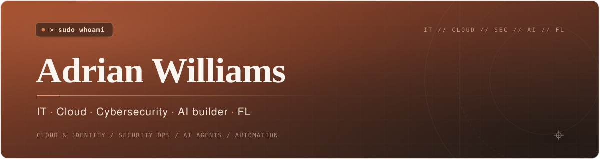

<p align="center">
  
</p>

<p align="center">
  <a href="https://git.io/typing-svg">
    
  </a>
</p>

<p align="center">
  
  
  
  
  
  
  <br />
  
  
  
  
  
  
</p>

---

### `01` // about me

```yaml
name: Adrian Williams
role: Technical Support Analyst, Identity & Access (City of Tallahassee)
education: BS Cyber Criminology (CS track), Florida State University
certs: [ISC2 Certified in Cybersecurity (CC)]
focus: [identity security, AI agents, local AI]
fun_fact: Third Culture Kid (Panama, Germany, Nigeria, Saudi Arabia, Spain)
```

---

### `02` // experience

**Technical Support Analyst — Identity & Access** · *City of Tallahassee*

- **Account Provisioning & Lifecycle** — Manage vendor account provisioning, onboarding/offboarding workflows, and directory hygiene across hybrid identity environments.
- **Directory & Group-Based Access** — Administer **Microsoft Entra ID** and on-premises **Active Directory** security groups to enforce least-privilege access across municipal applications.
- **Authentication & Policy Troubleshooting** — Resolve **Conditional Access** policy evaluations, **MFA** registration and enforcement issues, and sign-in blocks.
- **Incident & Compromised-Account Response** — Execute compromised-account containment: session revocation, credential resets, MFA re-registration, and sign-in log review.
- **Microsoft 365 Administration** — Handle day-to-day **M365** tenant administration, licensing assignments, mailbox permissions, and user support escalations.

---

### `03` // featured projects

| Project | Focus | Description | Access |
| :--- | :--- | :--- | :--- |
| **Sentinel ID** | `Entra ID` · `Python` · `AI` | AI identity security auditor for Microsoft Entra ID with read-only Graph inspection and approval-gated remediation. | [Repository](https://github.com/CsAdrian18/sentinel-id) · `[LINK]` |
| **MajorHub** | `React Native` · `iOS` · `Supabase` | iOS application for comparing college majors, career ROI, and universities side by side. | `[LINK]` |
| **Tolu** | `Raspberry Pi` · `Python` · `Local AI` | Offline-first local AI voice assistant running on a Raspberry Pi with low-latency wake-word and speech pipeline. | `[LINK]` |
| **Willtech** | `Next.js` · `TypeScript` · `Editorial` | Full consultancy website rebuild with a clean, performance-focused architecture. | `Private` · `[LINK]` |

---

### `04` // currently

- **learning:** Microsoft Graph API automation, SCIM provisioning patterns, and Entra Workload ID security
- **building:** **Sentinel ID** (automated Entra ID posture checks) and **Tolu** (local voice execution on Raspberry Pi)
- **reading:** *Designing Data-Intensive Applications* & enterprise Zero Trust identity architectures

---

### `05` // find me

<p align="center">
  <a href="[LINK]">
    
  </a>
  <a href="[LINK]">
    
  </a>
  <a href="https://www.tiktok.com/@adriandior1">
    
  </a>
  <a href="mailto:csadrian30@gmail.com">
    
  </a>
</p>

---

<p align="center">
  
  
</p>
